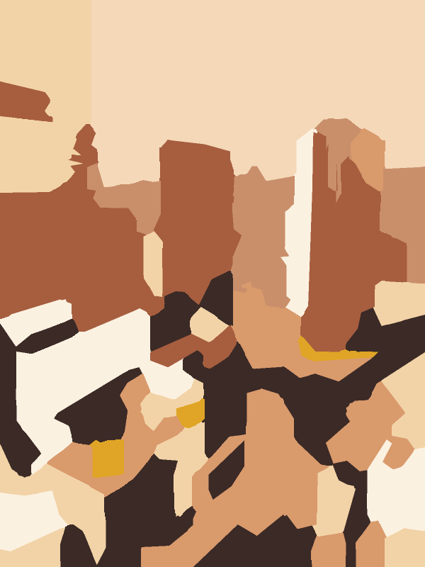
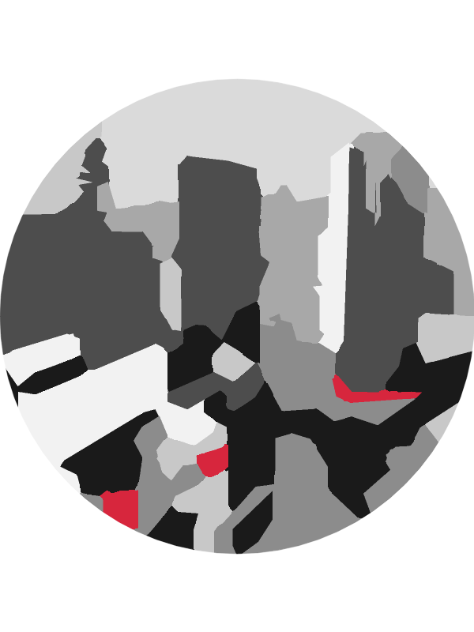
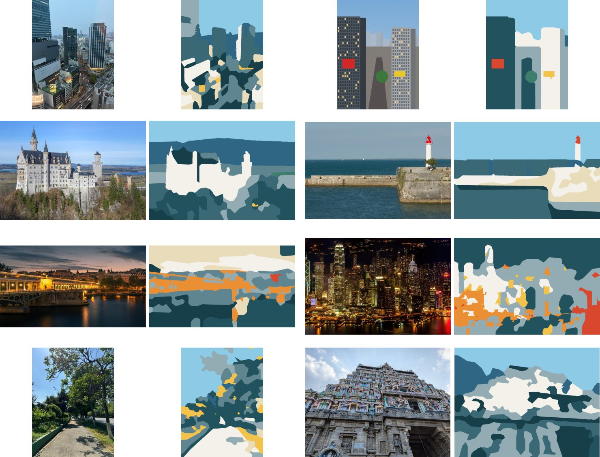

# photo2stamp

現地で撮った写真を、少ない色数のフラットなスタンプ風イラストに変換するCLIです。
画像生成AIは使わず、OpenCVの古典的な画像処理だけで動きます。GPUは不要で、800pxの写真1枚を数秒で処理します。

現在はPOC(概念実証)の段階です。写真の構図をそのまま残し、色と形を単純化します。
写真から要素を選んで配置し直すような意味的なデフォルメはしません。

## 変換例

左から順に、元写真、`teal`パレット(既定)、`warm`パレット、`mono`パレットを円形に切り抜いたものです。

| 元写真 | teal | warm | mono + circle |
|---|---|---|---|
|  |  |  |  |

SVG出力の例は[examples/photo_teal.svg](examples/photo_teal.svg)にあります。

## 複数の写真での結果

既定の設定のまま、性質の違う写真8枚を変換した結果です。左が元写真、右が変換結果です。



| 写真 | 結果 |
|---|---|
| 街の俯瞰(作者撮影) | 空と遠景の街並みが分かれ、目標のイメージに近い |
| 合成画像 | 看板・木・ビルは分かれるが、遠景が手前の白いビルとつながる |
| 城 | 白い城の後ろに遠景が青い帯で出て、城が浮き出る |
| 灯台 | 空・海・堤防・灯台が大きな面で分かれ、最もスタンプらしい |
| 夕景の橋 | 空を検出できず、照明が橙のアクセントとして広がる |
| 夜景 | 空が暗く検出できない。照明が細かく散らばる |
| 木陰の道 | 葉の細部が多く、まとまらない |
| 寺院 | 彫刻の細部が多く、まとまらない。雲の一部が遠景色になる |

合成画像は`scripts/make_synthetic.py`で生成しました。一覧は`scripts/gallery.py`で作り直せます。

### 写真の出典

`examples/free/`の写真はWikimedia CommonsのCC0の画像を、長辺800pxに縮小して使っています。

| ファイル | 作者 | 元画像 |
|---|---|---|
| castle.jpg | Wilfredor | [Neuschwanstein Castle 2024-02](https://commons.wikimedia.org/wiki/File:Neuschwanstein_Castle_2024-02.jpg) |
| harbour.jpg | Wilfredor | [Victoria Harbour skyscrapers](https://commons.wikimedia.org/wiki/File:Victoria_Harbour_skyscrapers.jpg) |
| lighthouse.jpg | Jebulon | [Lighthouse, harbor Saint-Martin-de-Ré](https://commons.wikimedia.org/wiki/File:Lighthouse,_harbor_Saint-Martin-de-R%C3%A9,_R%C3%A9_island,_Charente-Maritime,_France.jpg) |
| bridge.jpg | Pierre Blaché | [Bir-Hakeim bridge, Paris](https://commons.wikimedia.org/wiki/File:Bir-Hakeim_bridge,_Paris_24_June_2021.jpg) |
| street.jpg | Omina006 | [Street city](https://commons.wikimedia.org/wiki/File:Street_city.jpg) |
| temple.jpg | Anonymous0006 | [Thillai Nataraja Temple](https://commons.wikimedia.org/wiki/File:Thillai_Nataraja_Temple_(Chidambaram_Nataraja_Temple).jpg) |

## インストール

```bash
git clone https://github.com/shiyow5/photo2stamp.git
cd photo2stamp
uv sync            # または: pip install -e .
```

## 使い方

```bash
uv run photo2stamp photo.jpg -o out --svg
# out/photo.png と out/photo.svg ができる

uv run photo2stamp *.jpg -o out --palette warm --shape circle   # 丸いスタンプ形・暖色
uv run photo2stamp photo.jpg -o out --palette original          # 写真の色を平坦化して使う
```

Pythonから呼ぶ場合の例です。

```python
import cv2
from photo2stamp import StampConfig, stylize

result = stylize(cv2.imread("photo.jpg"), StampConfig(palette="teal", colors=8))
cv2.imwrite("stamp.png", result.image)
open("stamp.svg", "w").write(result.svg)
```

## 処理の流れ

| 段階 | 処理 | モジュール |
|---|---|---|
| 1 | 長辺を 800px に縮小 | `pipeline.py` |
| 2 | バイラテラルフィルタと mean-shift で、輪郭を残したまま細部を消す | `segment.smooth` |
| 3 | Lab 色空間の k-means で色を 8 クラスタに分ける | `segment.quantize` |
| 4 | 多数決フィルタでラベルの境界をならす | `segment.majority_filter` |
| 5 | 彩度の高い小領域(看板や照明)を独立したクラスタとして拾う。文字のすき間は閉じて1枚の面にする。画像の上端に接する領域は空とみなして拾わない | `segment.extract_accents` |
| 6 | 上端に接する明るい領域を空として扱う | `segment.extract_sky` |
| 7 | 空の直下にあり、すぐ上の空と色が近い画素を遠景とみなし、1色のシルエットにする | `segment.extract_far` |
| 8 | 明度の順に、面積で重み付けしてパレットの濃淡に割り当てる。空は空色、彩度の高い領域は色相が近いアクセント色にする | `palette.assign_colors` |
| 9 | 同じ色になったクラスタを統合し、小さな領域を隣の領域に吸収させる。アクセント色の領域は小さくても残す | `segment.merge_small_regions` |
| 10 | 輪郭を追跡し、Douglas-Peucker 法で頂点を減らし、垂直に近い辺を垂直にそろえる | `vectorize.labels_to_shapes` |
| 11 | 面積の大きい順に塗って PNG と SVG に書き出す | `vectorize.render_png` / `shapes_to_svg` |

10の「垂直にそろえる」処理は、建物の壁を直線にして建築物らしく見せるために入れています。

## 主なオプション

| オプション | 既定値 | 内容 |
|---|---|---|
| `--palette` | `teal` | `teal` / `warm` / `mono` / `original` |
| `--colors` | 8 | k-means のクラスタ数。増やすと細部が残る |
| `--majority` | 17 | 多数決フィルタの窓幅(px)。大きいほど形が大づかみになる |
| `--min-region` | 0.003 | 画像面積に対するこの割合より小さい領域を消す |
| `--simplify` | 0.005 | 多角形の簡略化の許容誤差(対角線長に対する割合) |
| `--snap-deg` | 12 | 垂直からこの角度以内の辺を垂直にする。0 で無効 |
| `--accent-chroma` | 28 | この彩度以上の領域をアクセント色にする |
| `--no-sky` | なし | 空の検出を切る |
| `--no-far` | なし | 遠景のシルエット化を切る |
| `--far-delta` | 20 | すぐ上の空との色差(Lab)がこの値以下の画素を遠景候補にする |
| `--tone-mapping` | `area` | `area`は面積で重み付けして濃淡を割り当てる(暗い写真でも明暗が出る)。`rank`はクラスタごとに順に1段ずつ割り当てる |
| `--shape` | `rect` | `circle` にすると円形に切り抜いた透過 PNG を出す |
| `--svg` | なし | PNG に加えて SVG も出力する |

## 制約

- 構図は写真のままなので、写っているものが多い写真ほど図形が細かく残ります。被写体を絞って撮ると結果が良くなります
- 色の割り当ては明度と面積だけで決めます。道路を明るい色にするといった、物の意味に応じた塗り分けはしません
- 窓の縦縞やガラスの格子のような、写真に細かく写っている模様は平滑化の段階で消えます
- 空の検出は「上端に接していて明るい」という条件だけで判定します。白い建物が上端に接していると空と判定されることがあります
- 遠景の判定は「空の直下にあって空と色が近い」という条件だけで行います。淡い灰色の建物が空の近くにあると遠景と区別できません(合成画像の右側のビルがこの例です)。雲が地平線近くまで垂れていると、雲の一部が遠景色になります(寺院の写真の左上)
- 夜景や夕焼けのように空が暗い・赤い写真では空を検出できず、照明がアクセント色として散らばります
- 木の葉や彫刻のように細部が多い被写体は、まとまりのない模様になります
- SVGは多角形を重ねて描くので、隣り合う図形のすき間に下の図形の色が細く見えることがあります。PNGはラベル画像を下地に塗ってからこの多角形を重ねるので、すき間は出ません

## 実験用スクリプト

`scripts/experiment.py`は、設定を変えた結果を横に並べた比較画像を作るスクリプトです。各変種は`名前:項目=値,項目=値`の形で指定し、項目には`StampConfig`のフィールド名を使います。

```bash
uv run python scripts/experiment.py examples/photo.jpg -o sheet.png \
    "rank:tone_mapping=rank" "area:tone_mapping=area" "blocky:majority=25,min_region=0.006"
```

## 開発

```bash
uv sync
uv run pytest            # 単体・結合・CLIのE2Eテストとカバレッジ
```

## ライセンス

MIT License。詳細は[LICENSE](LICENSE)を参照してください。
