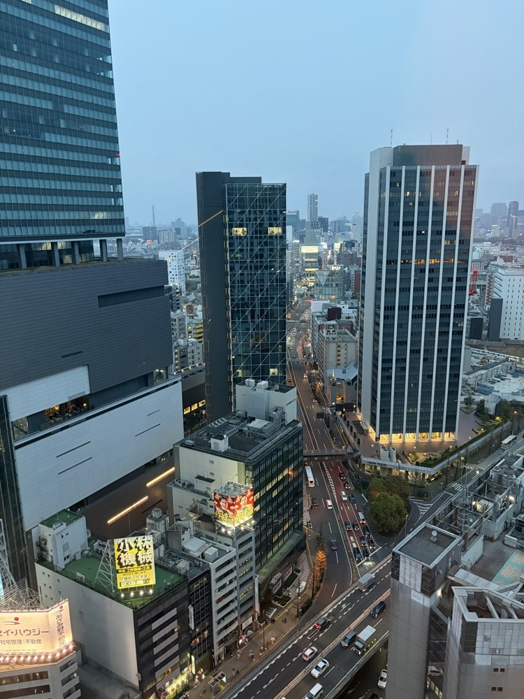
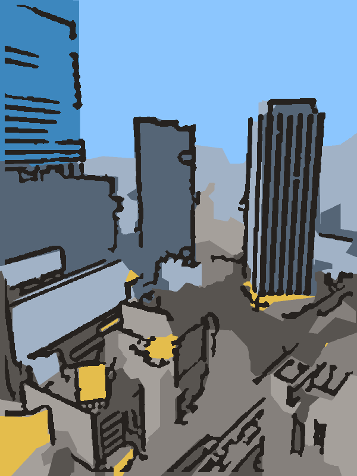
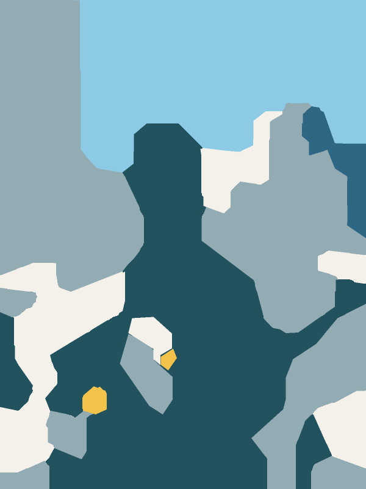
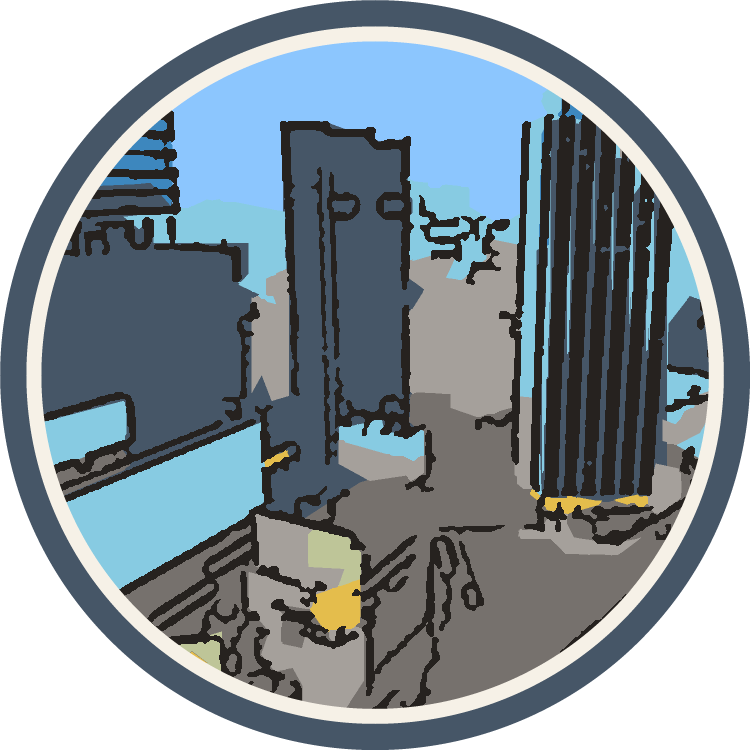
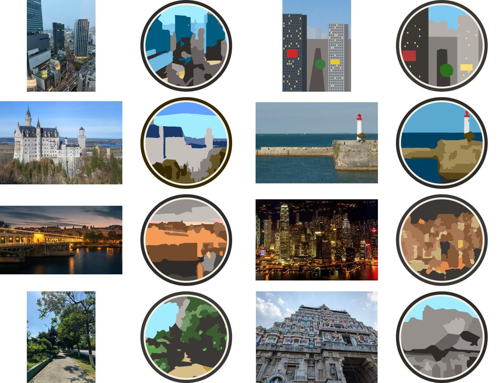

# photo2stamp

[](https://github.com/shiyow5/photo2stamp/actions/workflows/test.yml)

写真を、少ない色数のフラットなスタンプ風イラストに変換するツールです。CLIとPythonライブラリの両方で使えます。
画像生成AIは使わず、OpenCVの古典的な画像処理だけで動かしています。GPUは不要で、800pxの写真1枚なら数秒です。

写真を平らな面に分けて色を少数の基準色にそろえ、その上に輪郭線を描きます。
色は写真の色相(空は青、木は緑)を残すので、抽象化しても何が写っているか分かります。
夜景では輪郭線の代わりに、窓の灯りを点にして描くのが特徴です。
円形や角丸を選ぶと、縁取りの付いたスタンプの形(透過PNG)で出力します。

## 変換例

左から順に、元写真、`natural`配色(既定)、`teal`配色、`natural`の円形スタンプです。

| 元写真 | natural | teal | natural + circle |
|---|---|---|---|
|  |  |  |  |

SVG出力の例は[examples/photo_natural.svg](examples/photo_natural.svg)にあります。

性質の違う写真8枚を、既定の設定のまま円形スタンプにした結果です。左が元写真、右が変換結果です。



ほかの一覧もあります。

| 一覧 | 設定 |
|---|---|
| [gallery.jpg](examples/gallery.jpg) | 枠なし(`--shape rect`) |
| [gallery_circle_after.jpg](examples/gallery_circle_after.jpg) | 枠なしの絵をそのまま丸く切り抜く(`--shape circle --crop after`) |
| [gallery_teal.jpg](examples/gallery_teal.jpg) | `teal`配色 |

## インストール

Python 3.10以上が必要です。

```bash
git clone https://github.com/shiyow5/photo2stamp.git
cd photo2stamp
uv sync            # または: pip install .
```

## 使い方

```bash
uv run photo2stamp photo.jpg -o out --svg
# out/photo.png と out/photo.svg ができる

uv run photo2stamp *.jpg -o out --shape circle                  # 縁取り付きの丸いスタンプ
uv run photo2stamp *.jpg -o out --shape circle --crop after      # 枠なしの絵を丸く切り抜く
uv run photo2stamp photo.jpg -o out --work-size 150 --colors 5   # もっと大胆に抽象化する
uv run photo2stamp photo.jpg -o out --line-width 3               # 輪郭線を太くする
uv run photo2stamp photo.jpg -o out --palette original          # 写真の色を平坦化して使う
```

出力ファイル名は入力と同じ名前で、拡張子が`.png`(と`.svg`)になります。
名前が重なる入力は`photo_1.png`のように番号を付けて書き分けます。
読めないファイルがあっても残りの処理は続け、その場合の終了コードは1です。

Pythonから呼ぶ場合の例です。

```python
import cv2
from photo2stamp import StampConfig, stylize

result = stylize(cv2.imread("photo.jpg"), StampConfig(shape="circle"))
cv2.imwrite("stamp.png", result.image)   # BGR、円形・角丸のときはBGRA
with open("stamp.svg", "w", encoding="utf-8") as f:
    f.write(result.svg)
```

`StampConfig`のフィールド名には、下のオプション名のハイフンをアンダースコアに替えたものを使います。

## オプション

| オプション | 既定値 | 内容 |
|---|---|---|
| `-o`, `--out-dir` | `out` | 出力先のフォルダ |
| `--svg` | なし | PNGに加えてSVGも出力する |
| `--shape` | `rect` | `circle`/`rounded`にすると正方形に切り抜き、縁取り付きのスタンプにする |
| `--crop` | `before` | `circle`/`rounded`の切り抜き方。`before`は写真を先に正方形に切り、その範囲だけで色と線を決める。`after`は写真全体で絵を作ってから切り抜くので、`rect`の絵と同じ色・線になる(夜モードの判定も写真全体で行う) |
| `--ring` / `--ring-gap` | 0.035 / 0.02 | 縁取りリングの太さと、リング内側のすき間(スタンプの大きさに対する割合)。`--ring 0`で縁取りなし |
| `--palette` | `natural` | `natural`(写真の色相を残して整える) / `teal` / `warm` / `mono`(固定の配色を明るさの順に割り当てる) / `original`(写真の色そのまま) |
| `--colors` | 8 | 色分けの数(k-meansのクラスタ数) |
| `--work-size` | 0(自動) | 色分けに使う画像の長辺(px)。小さいほど抽象的になる。0なら細部の量から500〜400pxを選ぶ |
| `--max-size` | 800 | 出力の長辺(px)。0で元の大きさのまま |
| `--no-lines` | なし | 輪郭線を描かない(色の面だけ) |
| `--line-width` | 1.5 | 輪郭線の太さ(600pxの画像に対するpx) |
| `--line-threshold` | 0.012 | 線を引くのに必要なエッジの強さ。大きいほど線が減る |
| `--line-min-length` | 0.07 | 長辺に対するこの割合より短い線を捨てる |
| `--line-sigma` | 2.0 | 線を拾う大きさ。大きいほど大きな構造だけになる |
| `--night` | `auto` | 夜モード(暗い面に灯りの点)。`auto`は写真の明るさで判定。`on`/`off`で強制 |
| `--smoother` | `l0` | 面を平らにする方法。`l0`(L0勾配最小化)か`meanshift` |
| `--l0-lambda` | 0.04 | L0平滑化の強さ。大きいほど面が平らになる |
| `--smooth` | 1 | `--smoother meanshift`のときの平滑化の回数 |
| `--majority` | 3 | 多数決フィルタの窓(作業画像のpx)。大きいほど形が角張る |
| `--min-region` | 0.002 | 画像面積に対するこの割合より小さい領域を消す |
| `--simplify` | 0.006 | 多角形の簡略化の許容誤差(対角線長に対する割合) |
| `--snap-deg` | 12 | 垂直からこの角度以内の辺を垂直にする。0で無効 |
| `--accent-chroma` | 28 | この彩度より鮮やかな小領域(看板や照明)を残す |
| `--no-sky` | なし | 空の検出を切る |
| `--no-far` / `--far-delta` | なし / 20 | 遠景のシルエット化(固定配色のときだけ働く)を切る / 空の色にどこまで近ければ遠景とみなすか |
| `--tone-mapping` | `area` | 明るさの割り振り方。`area`は面積で均す、`rank`は色ごとに1段ずつ |
| `--seed` | 0 | k-meansの乱数の種 |
| `--version` | | 版を表示する |

## 処理の流れ

| 段階 | 処理 | モジュール |
|---|---|---|
| 1 | 円形・角丸のときは正方形に切り抜く。位置はエッジの最も多い範囲(主役の被写体)に合わせる(`--crop after`では最後に切り抜く) | `pipeline.square_window` |
| 2 | 長辺を800pxに縮め、細部の量(エッジ密度)から作業用の大きさ(500〜400px)を決める | `pipeline.auto_work_size` |
| 3 | L0勾配最小化で、重要な輪郭を残したまま面を平らにする | `pipeline._smooth` |
| 4 | Lab色空間のk-meansで8色に分ける。色み(a, b)を明るさの2倍に重み付けし、同じ明るさの緑の木と灰色の道を別の色にする | `segment.quantize` |
| 5 | 彩度の高い小領域(看板や照明)を拾い、上端に接するなめらかな領域を空とする | `segment.extract_accents` / `extract_sky` |
| 6 | 色を決める。`natural`では色相を8方向に、明るさを一定の段差にそろえ、彩度は写真の彩度に比例させる。うっすらした色味は光の色とみなして灰色に残す | `palette.natural_colors` |
| 7 | 小さな領域を隣に吸収させ、ラベルを元の大きさになめらかに拡大し、多角形にする | `segment.merge_small_regions` / `upscale_labels` / `vectorize.labels_to_shapes` |
| 8 | 輪郭線を描く。600pxの写真にDoG(ガウシアン差分)をかけ、短い線を捨てて太さをそろえる。暗い面の上には描かない | `lines.dog_lines` / `clean_lines` |
| 9 | 夜景(明るさの中央値が45未満)では面を暗く保ち、輪郭線の代わりに窓の灯りを灯り色の点で描く | `pipeline.is_night` / `lines.light_spots` |
| 10 | PNGとSVGに書き出す。円形・角丸のときは外周にリングと紙色のすき間を描く | `vectorize.render_png` / `frame_stamp` / `shapes_to_svg` |

それぞれの設定値を選んだ理由、試してやめた方法、参考にした研究は[docs/development-notes.md](docs/development-notes.md)にまとめています。
設定を変える前に読んでください。

## 制約

- 固定配色(`teal`など)は色を明るさの順に割り当てるので、青空が白、木が黄色のように物の色が入れ替わります。被写体を見せたいときは`natural`を使ってください
- 日陰の葉は写真では暗く青みがかっているため、緑ではなく暗い灰色で塗られます
- 多色の模様(寺院の彫刻など)は、色が平均されて灰色や青の面になります
- 夜モードの判定は写真全体の明るさだけで行います。夕景のように半分だけ暗い写真は昼の描き方になります
- 正方形の切り抜き位置は「エッジが最も多い範囲」で決めます。細部の多いものが主役でない写真では、主役が外れることがあります
- 空は「上端に接していて、なめらか」という条件で判定します。上端に接する無地の壁も空と判定されることがあります
- 雲の縁も輪郭線として描かれます
- SVGは多角形を重ねて描くので、隣り合う図形のすき間に下の図形の色が細く見えることがあります

## 開発

```bash
uv sync
uv run pytest            # 単体・結合・CLIのE2Eテストとカバレッジ
```

GitHub Actionsで、pushとプルリクエストのたびにPython 3.10と3.13でテストを実行します。CIではカバレッジが80%を下回ると失敗にしています。

例の画像を作り直すときは、次のスクリプトを使ってください。

```bash
uv run python scripts/make_synthetic.py                      # examples/synthetic_city.png を作る
uv run python scripts/gallery.py -o examples/gallery_circle.jpg --shape circle \
    examples/photo.jpg examples/synthetic_city.png examples/free/*.jpg
```

`gallery.py`で指定できる項目は`--shape`、`--palette`、`--crop`、`--columns`です。

## 写真の出典

`examples/photo.jpg`は作者の撮影です。`examples/free/`の写真はWikimedia CommonsのCC0の画像を、長辺800pxに縮小して使っています。

| ファイル | 作者 | 元画像 |
|---|---|---|
| castle.jpg | Wilfredor | [Neuschwanstein Castle 2024-02](https://commons.wikimedia.org/wiki/File:Neuschwanstein_Castle_2024-02.jpg) |
| harbour.jpg | Wilfredor | [Victoria Harbour skyscrapers](https://commons.wikimedia.org/wiki/File:Victoria_Harbour_skyscrapers.jpg) |
| lighthouse.jpg | Jebulon | [Lighthouse, harbor Saint-Martin-de-Ré](https://commons.wikimedia.org/wiki/File:Lighthouse,_harbor_Saint-Martin-de-R%C3%A9,_R%C3%A9_island,_Charente-Maritime,_France.jpg) |
| bridge.jpg | Pierre Blaché | [Bir-Hakeim bridge, Paris](https://commons.wikimedia.org/wiki/File:Bir-Hakeim_bridge,_Paris_24_June_2021.jpg) |
| street.jpg | Omina006 | [Street city](https://commons.wikimedia.org/wiki/File:Street_city.jpg) |
| temple.jpg | Anonymous0006 | [Thillai Nataraja Temple](https://commons.wikimedia.org/wiki/File:Thillai_Nataraja_Temple_(Chidambaram_Nataraja_Temple).jpg) |

## ライセンス

MIT License。詳細は[LICENSE](LICENSE)を参照してください。
